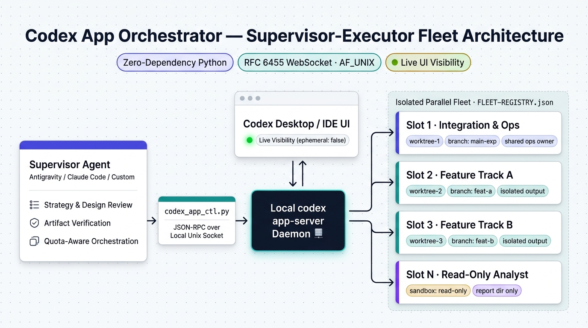
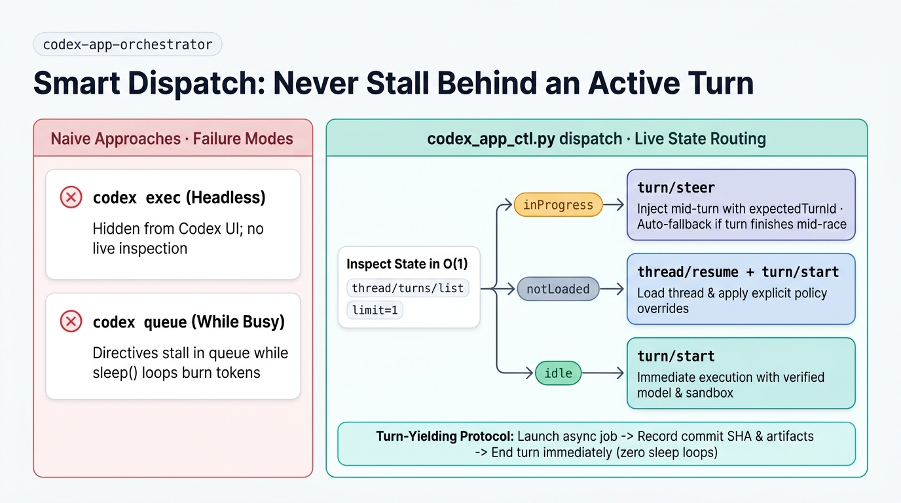
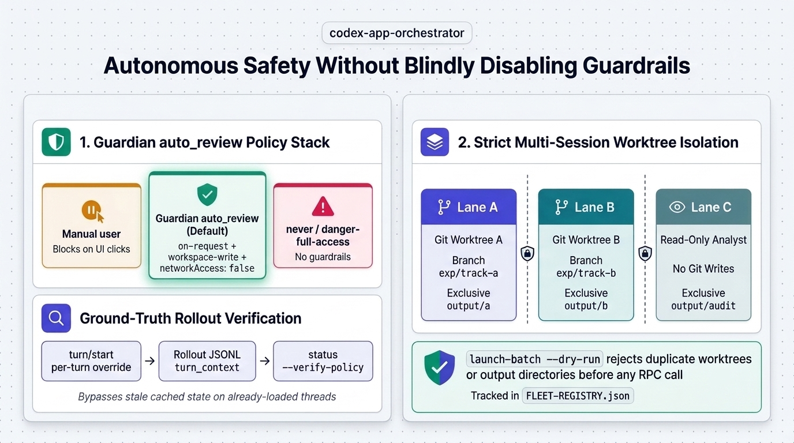
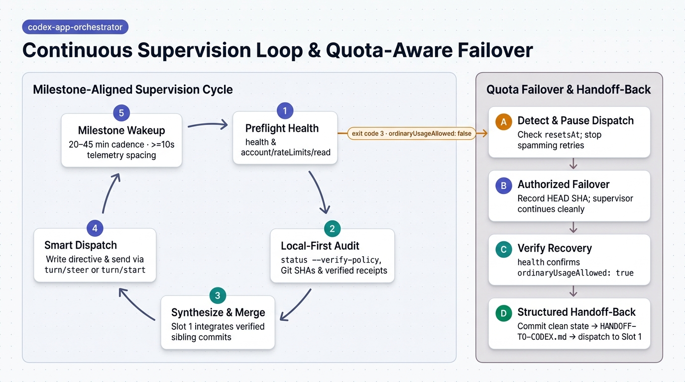
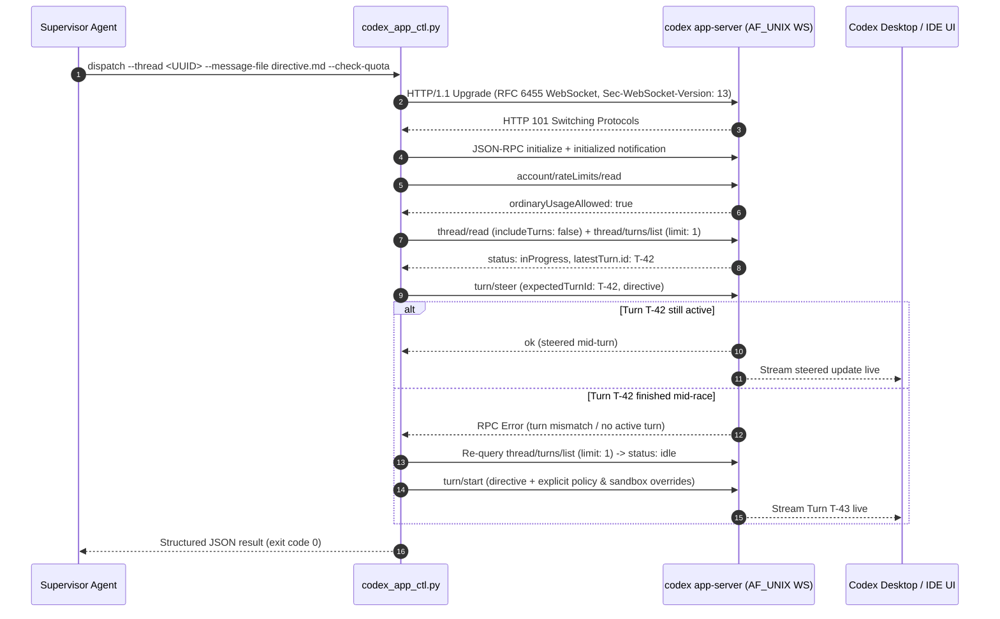

# Codex App Orchestrator

> **A portable Agent Skill and zero-dependency Python controller for orchestrating 1–5 persistent, live, UI-visible Codex execution sessions through the official local `codex app-server` WebSocket JSON-RPC daemon.**

[](./LICENSE)
[](#requirements)
[](#under-the-hood-protocol--architecture)
[](#install)

---

## Overview

Modern long-horizon software engineering and iterative research work best under a **Supervisor–Executor** split: one high-level coordinating agent (such as Antigravity, Claude Code, or a custom orchestrator) owns strategy, literature and design review, hypothesis prioritization, artifact verification, and synthesis—while **1–5 persistent Codex sessions** execute concrete coding, debugging, testing, and diagnostic tracks in parallel.

In practice, wiring agents together naively breaks down quickly: headless `codex exec` runs vanish from the user's sight, queued follow-up commands stall behind long turns, disabling approvals trades away safety, and uncoordinated parallel agents collide on Git locks and shared logs.

**`codex-app-orchestrator`** solves all five problems in a single self-contained, zero-dependency skill package built directly on top of the official local `codex app-server` daemon.



> [!TIP]
> **Why live UI visibility matters:** Every session launched by `codex-app-orchestrator` is created with `ephemeral: false` over the local `codex app-server` control socket. Sessions appear immediately in the Codex Desktop or IDE extension sidebar under their workspace, streaming real-time tool calls, diffs, and reasoning so humans can watch or intervene at any moment.

---

## Why This Pattern?

| Naive Orchestration Approach | Common Failure Mode | How `codex-app-orchestrator` Solves It |
| :--- | :--- | :--- |
| **`codex exec` / `codex exec resume`** | Runs in a standalone headless process—invisible in Codex Desktop or IDE UI. | Drives persistent (`ephemeral: false`) threads via `codex app-server` so every turn streams live in the sidebar. |
| **`codex queue` while busy** | Directives silently sit in the follow-up queue until a long turn finishes; polling loops burn tokens. | **`dispatch`** inspects live turn state in O(1) and sends **`turn/steer`** (`expectedTurnId`) for immediate mid-turn injection, paired with the **Turn-Yielding Protocol**. |
| **`never` / `danger-full-access`** | Eliminates manual UI click-fatigue by stripping away safety guardrails completely. | Defaults to **Guardian `auto_review`** (`approvalPolicy: "on-request"`, `approvalsReviewer: "auto_review"`, `sandbox: "workspace-write"`, `networkAccess: false`), verified against rollout `turn_context`. |
| **Uncoordinated parallel workers** | Git index lock errors, branch collisions, shared stash corruption, and overwritten reports. | **`launch-batch`** validates isolated `git worktree` + unique `output_dir` boundaries before making any RPC calls and writes a unified `FLEET-REGISTRY.json`. |
| **Blind retries during rate limits** | Repeatedly dispatches failing turns or silently drops work when usage limits hit. | **`health`** and `--check-quota` check `account/rateLimits/read` proactively (exiting with code `3` when `ordinaryUsageAllowed` is `false`) to trigger clean pause or authorized failover. |

---

## Core Capability Deep Dives

### 1. Non-Blocking Smart Dispatch & Mid-Turn Steering

One of the sharpest failure modes in multi-agent orchestration is **directive starvation**: an executor is halfway through a long build or test run when the supervisor discovers a bug, refined constraint, or priority shift. Legacy queue commands simply park the correction behind the active turn—waiting minutes or hours while the executor keeps heading in the wrong direction.

`codex_app_ctl.py dispatch` eliminates blocking by checking the target thread's live turn state in **O(1)** via `thread/turns/list` (`limit: 1`, avoiding expensive full-history downloads) and routing dynamically across three states:

- **`inProgress` → `turn/steer`**: Injects the directive immediately into the running turn with `expectedTurnId`. If the turn completes during the brief race window between inspection and steering, `dispatch` detects the turn-mismatch RPC error, re-queries once, and falls through cleanly to `turn/start` so no directive is ever dropped.
- **`notLoaded` → `thread/resume` + `turn/start`**: Loads the persisted session into daemon memory (`excludeTurns: true` to stay lightweight) and starts the new turn with explicit policy, model, and sandbox overrides.
- **`idle` → `turn/start`**: Launches the turn immediately with explicit per-turn configuration overrides.



Paired with smart routing is the **Turn-Yielding Protocol**: workers are instructed never to sit inside a `sleep()` loop waiting on builds, CI pipelines, or remote jobs longer than ~2 minutes. Instead, each worker launches the async job, records job IDs, commit SHAs, and artifact paths, and **immediately yields back to `idle`**.

---

### 2. Autonomous Safety: Guardian `auto_review` & Rollout Verification

Unattended agent workflows often fall into a false dichotomy: either leave manual approvals on (stalling every time a worker needs an approval click) or disable sandboxing entirely (`never` + `danger-full-access`).

`codex-app-orchestrator` standardizes on the middle path that gives you both **autonomy and defense-in-depth**:

1. **Guardian `auto_review` by Default**:
   - `approvalPolicy: "on-request"`
   - `approvalsReviewer: "auto_review"` (routes risky or escalated actions to Codex's contextual Guardian reviewer subagent)
   - `sandbox: "workspace-write"` with `networkAccess: false` (or `sandbox: "read-only"` for analyst/auditor slots)
2. **Eliminating the Already-Loaded Thread Policy Gotcha**:
   - Calling `thread/resume` alone on a thread already resident in daemon memory can leave cached in-memory policy settings active until the thread unloads.
   - `codex_app_ctl.py dispatch` passes explicit `approvalPolicy`, `approvalsReviewer`, and `sandboxPolicy` fields on **every `turn/start` call**, guaranteeing the active policy takes effect immediately.
3. **Ground-Truth Rollout Verification**:
   - Instead of trusting scheduler metadata alone, `status --verify-policy` and `inspect-rollout` parse the thread's actual rollout JSONL `turn_context` records to verify effective `approval_policy`, `approvals_reviewer`, `sandbox_policy`, `model`, and `effort`.



---

### 3. Strict Multi-Session Worktree Isolation

Running 2–5 parallel Codex writers inside a single working tree almost guarantees Git index lock contention, tangled branches, and clobbered logs. `codex-app-orchestrator` enforces clean physical and operational boundaries:

| Fleet Role | Isolation Boundary | Primary Responsibilities |
| :--- | :--- | :--- |
| **Slot 1 · Primary Integration & Ops** | Dedicated integration `worktree` + branch + exclusive `output_dir`; sole `cluster_write_owner` | Merges or cherry-picks verified commits from sibling slots, owns shared operational logs and external job launches. |
| **Slots 2..(N−1) · Feature / Experiment Tracks** | One dedicated `git worktree` + unique branch + exclusive `output_dir` per slot | Parallel implementation, unit tests, and design notes; zero edits to sibling worktrees or shared boards; WIP commits instead of shared `git stash`. |
| **Slot N · Read-Only Analyst / Auditor** | No Git working tree writes (`read_only: true` / `sandbox: "read-only"`) + exclusive report directory | Mines verified local artifacts, runs error analysis, audits sibling branches, and drafts figures/tables. |

> [!IMPORTANT]
> **Pre-flight collision rejection:** Before making a single RPC call, `launch-batch` (and `launch-batch --dry-run`) canonicalizes every slot's paths and aborts if two writer slots share a write root (their `worktree`, or `cwd` when there is none), a `branch` is claimed twice, `output_dir`s are equal or nested, slot numbers repeat, or more than one slot is `cluster_write_owner`. Nested writer worktrees, worktree-less writers, and `danger-full-access` / `never` policies are allowed but listed as `warnings`. Validation errors are returned as a JSON object (exit code 1), never a traceback. Every successfully launched fleet is tracked in a single `FLEET-REGISTRY.json` manifest for O(1) fleet-wide status sweeps.

---

### 4. Continuous Supervision Loop & Quota-Aware Failover

For multi-round engineering and research runs spanning hours, `codex-app-orchestrator` formalizes a calm, low-noise supervision rhythm that respects both human attention and shared compute resources:

1. **Preflight Health & Quota Check**: Query daemon status, defaults from `~/.codex/config.toml`, and live rate limits via `account/rateLimits/read`.
2. **Local-First Artifact Audit**: Run `status --registry FLEET-REGISTRY.json --verify-policy --last-message`, inspect Git commit SHAs in each worktree, and read emitted JSON receipts. Completion is claimed **only from verified artifacts**, never from a thread going `idle` or a scheduler returning success.
3. **Synthesize & Integrate**: Review deliverables across tracks and instruct Slot 1 to integrate verified commits cleanly.
4. **Smart Dispatch**: Issue compact, self-contained round directives (using [`examples/directive.example.md`](./examples/directive.example.md)) via `dispatch --check-quota`.
5. **Milestone-Aligned Wakeups & Telemetry Hygiene**: Schedule check-ins at real milestones (typically 20–45 minutes) and space any live external telemetry checks by at least 10 seconds (preferring 15–60s+ or passive single-collector logs).



When usage or rate limits trigger (`ordinaryUsageAllowed == false`), `--check-quota` returns **exit code `3`** (`quota_exhausted`) along with `resetsAt` metadata—allowing the supervisor to halt retries cleanly, optionally assume authorized failover on the integration branch, and execute a structured **Handoff-Back** (`HANDOFF-TO-CODEX.md` containing exact `HEAD` commit SHAs, active jobs, verified artifacts, and next steps) once `health` confirms quota recovery.

---

## Under the Hood: Protocol & Architecture

A standout engineering choice in `codex-app-orchestrator` is that [`scripts/codex_app_ctl.py`](./scripts/codex_app_ctl.py) has **zero external dependencies**—it runs on stock **Python 3.9+ standard library only** (`socket`, `struct`, `base64`, `json`, `subprocess`, `argparse`). No `pip install`, no virtual environment, and no extra MCP sidecar server are required.

### Socket Discovery Priority

`codex_app_ctl.py` resolves the local `codex app-server` Unix control socket automatically in strict priority order:

1. `--socket <path>` explicit CLI argument
2. `CODEX_APP_SERVER_SOCKET` environment variable
3. `codex app-server daemon version` JSON output (`socketPath`, validating `status == "running"`)
4. Fallback `$CODEX_HOME/app-server-control/app-server-control.sock` (or `~/.codex/app-server-control/app-server-control.sock`)

### Wire Protocol & `turn/steer` Race-Fallback Flow



> [!NOTE]
> The built-in RFC 6455 WebSocket client natively handles masked client frames, server-initiated `PING (0x9)` → `PONG (0xA)` keepalives, multi-frame fragmented text messages (`FIN=0` + continuation `0x0`), extended 16-bit/64-bit payload lengths, and unsolicited server notifications without dropping RPC responses.

---

## Install

### Via `npx skills` (AgentSkills ecosystem)

```bash
npx skills add CalicoCat-117/codex-app-orchestrator --skill codex-app-orchestrator --global
```

To also link Claude Code explicitly alongside universal AgentSkills targets:

```bash
npx skills add CalicoCat-117/codex-app-orchestrator --skill codex-app-orchestrator --global --agent claude-code
```

*(For a private repository, ensure GitHub authentication is configured on the machine.)*

### Manual Install — Antigravity

Copy or symlink this repository into Antigravity's global or workspace skills folder:

```bash
# Global (all workspaces)
mkdir -p ~/.gemini/config/skills
cp -r /path/to/codex-app-orchestrator ~/.gemini/config/skills/codex-app-orchestrator

# Or project-scoped
mkdir -p /path/to/project/.agents/skills
cp -r /path/to/codex-app-orchestrator /path/to/project/.agents/skills/codex-app-orchestrator
```

### Manual Install — Claude Code / Codex

```bash
# Claude Code
mkdir -p ~/.claude/skills
cp -r /path/to/codex-app-orchestrator ~/.claude/skills/codex-app-orchestrator

# Codex
mkdir -p "${CODEX_HOME:-$HOME/.codex}/skills"
cp -r /path/to/codex-app-orchestrator "${CODEX_HOME:-$HOME/.codex}/skills/codex-app-orchestrator"
```

---

## Requirements

- **Python `>= 3.9`** (standard library only — zero external packages).
- **Codex CLI** with local `app-server` daemon support (tested with `codex-cli 0.169.0` on Linux).
- Running local daemon (`codex app-server daemon start` if not already active).

---

## Quickstart

```bash
# 1. Verify daemon health, defaults, and quota availability
python3 scripts/codex_app_ctl.py health --pretty

# 2. List existing UI-visible sessions
python3 scripts/codex_app_ctl.py list --limit 10 --pretty

# 3. Launch a single persistent session under Guardian auto_review
python3 scripts/codex_app_ctl.py create \
  --name "Worker · Auth Refactor" \
  --cwd /abs/path/to/repo \
  --prompt "Inspect auth.py, propose minimal fix, run tests, and end your turn." \
  --check-quota --pretty

# 4. Inspect status, render a plain principle-first caption, or verify rollout policy
python3 scripts/codex_app_ctl.py caption <THREAD_UUID>
python3 scripts/codex_app_ctl.py status <THREAD_UUID> --verify-policy --last-message --pretty

# 5. Send a directive or live mid-turn steering update (never stalls in queue)
python3 scripts/codex_app_ctl.py dispatch \
  --thread <THREAD_UUID> \
  --message "Add regression test for expired tokens before committing." \
  --check-quota --pretty

# 6. Validate and launch a multi-session isolated fleet
python3 scripts/codex_app_ctl.py launch-batch --spec examples/fleet-spec.example.json --dry-run --pretty
python3 scripts/codex_app_ctl.py launch-batch \
  --spec /abs/path/to/fleet-spec.json \
  --registry-out /abs/path/to/FLEET-REGISTRY.json \
  --check-quota --pretty
```

---

## CLI Subcommands

| Command | Description | Key Flags |
| :--- | :--- | :--- |
| `health` | Query daemon version, socket path, configured defaults, quota (`account/rateLimits/read`), and loaded threads. | `--pretty` |
| `list` | Search/list persisted or loaded threads (state-DB-only by default for millisecond lookups). | `--search`, `--cwd`, `--limit`, `--archived`, `--loaded-only`, `--scan-rollouts` |
| `status` | O(1) live status + latest turn check via `thread/turns/list`. | `--registry`, `--verify-policy`, `--last-message` |
| `caption` | Render a readable, unembellished, principle-first caption from a live thread, registry, or offline rollout. | `--registry`, `--path`, `--max-chars`, `--show-policy`, `--json` |
| `create` | Create a persistent UI-visible thread (`thread/start` + `thread/name/set` + optional Turn-1 `turn/start`). | `--name`, `--cwd`, `--prompt`, `--prompt-file`, `--approval-policy`, `--approvals-reviewer`, `--sandbox`, `--no-caption-guide`, `--check-quota` |
| `launch-batch` | Validate isolation constraints, launch/reuse a fleet from JSON spec, and emit `FLEET-REGISTRY.json`. | `--spec`, `--registry-out`, `--dry-run`, `--check-quota` |
| `dispatch` | Smart non-blocking send: `turn/steer` if `inProgress`, `thread/resume` + `turn/start` if `notLoaded`, `turn/start` if `idle`. | `--thread`, `--message`, `--message-file`, `--steer-only`, `--queue-only`, `--check-quota` |
| `set-policy` | Apply `approvalPolicy`, `approvalsReviewer`, `sandbox`, and optional `model`/`effort` via `thread/resume`. | `--approval-policy`, `--approvals-reviewer`, `--sandbox`, `--model`, `--effort` |
| `interrupt` | Gracefully stop an active turn via `turn/interrupt` (auto-detects active turn ID). | `--thread`, `--turn` |
| `inspect-rollout` | Read-only inspection of rollout JSONL for ground-truth `turn_context`, recent messages, and errors. | `--thread` or `--path` (100% offline), `--last-n` |
| `archive` / `unarchive` / `delete` | Thread lifecycle cleanup. | `<THREAD_UUID>...` |

**Exit Codes:** `0` = success · `1` = RPC, socket, or validation error · `3` = quota exhausted (`ordinaryUsageAllowed == false`).

---

## Repository Structure

```text
codex-app-orchestrator/
├── SKILL.md                                # Core skill runbook (progressive disclosure)
├── README.md                               # Illustrated English overview & reference
├── assets/
│   ├── 01-architecture.jpg                 # Supervisor-Executor fleet architecture diagram
│   ├── 02-smart-dispatch.jpg               # Non-blocking smart dispatch & Turn-Yielding diagram
│   ├── 03-guardian-isolation.jpg           # Guardian auto_review & worktree isolation visual
│   └── 04-supervision-failover.jpg         # Continuous supervision loop & quota failover visual
├── scripts/
│   └── codex_app_ctl.py                    # Zero-dependency WebSocket JSON-RPC controller
├── references/
│   ├── protocol-and-policy.md              # Wire protocol, RPC schemas, Guardian auto_review, troubleshooting
│   └── fleet-and-supervision-patterns.md   # Worktree isolation, Turn-Yielding, supervision cadence, failover
├── examples/
│   ├── fleet-spec.example.json             # Multi-session launch specification template
│   └── directive.example.md                # Structured round directive template
├── tests/
│   ├── test_codex_app_ctl.py               # Unit & mock RFC 6455 Unix-socket server test suite
│   └── smoke_live_daemon.py                # Opt-in live daemon smoke test (read-only or self-cleaning lifecycle)
└── LICENSE                                 # MIT License
```

---

## Testing

```bash
# 1. Offline unit + mock RFC 6455 Unix-socket server tests (safe anywhere, ~15 MB RAM, ~3 s)
python3 -m unittest discover -s tests -v

# 2. Read-only live daemon smoke test (zero threads created or mutated)
python3 tests/smoke_live_daemon.py

# 3. Full live lifecycle smoke test (creates 1 temp thread, verifies rollout policy, tests dispatch/interrupt, deletes temp thread)
python3 tests/smoke_live_daemon.py --lifecycle
```

---

## License

[MIT](./LICENSE)
